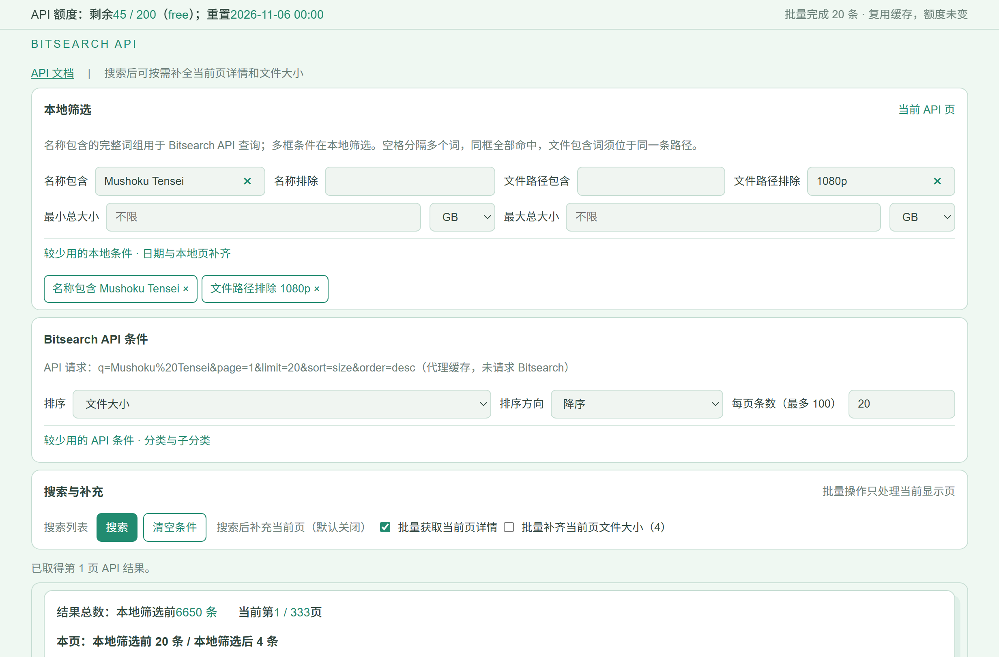
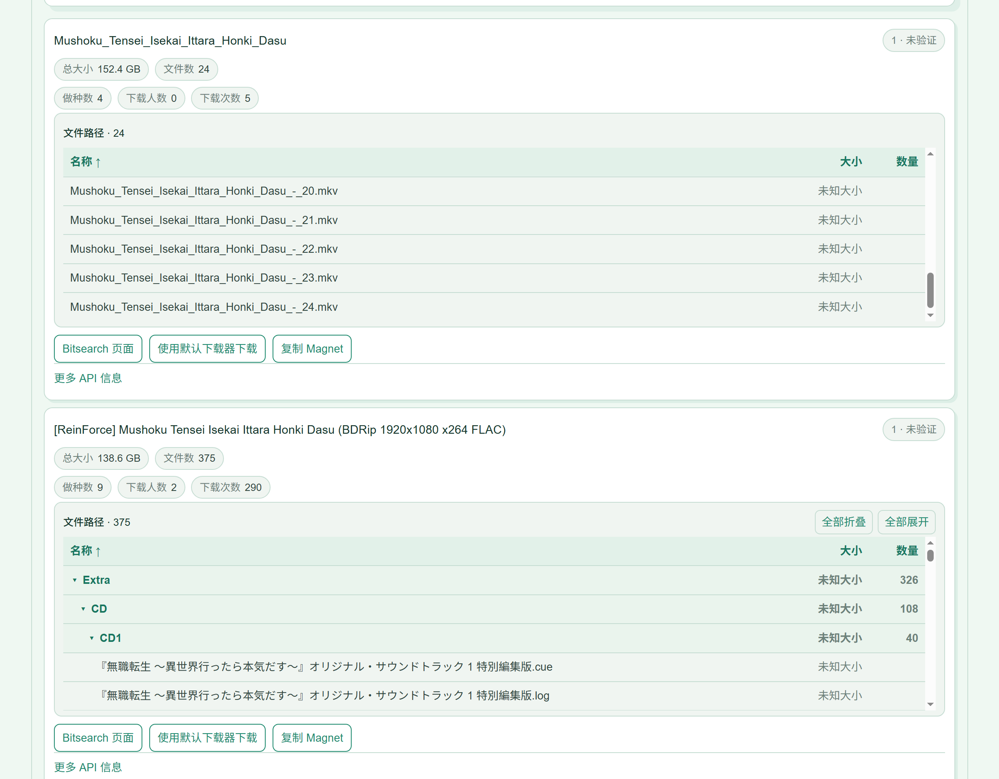
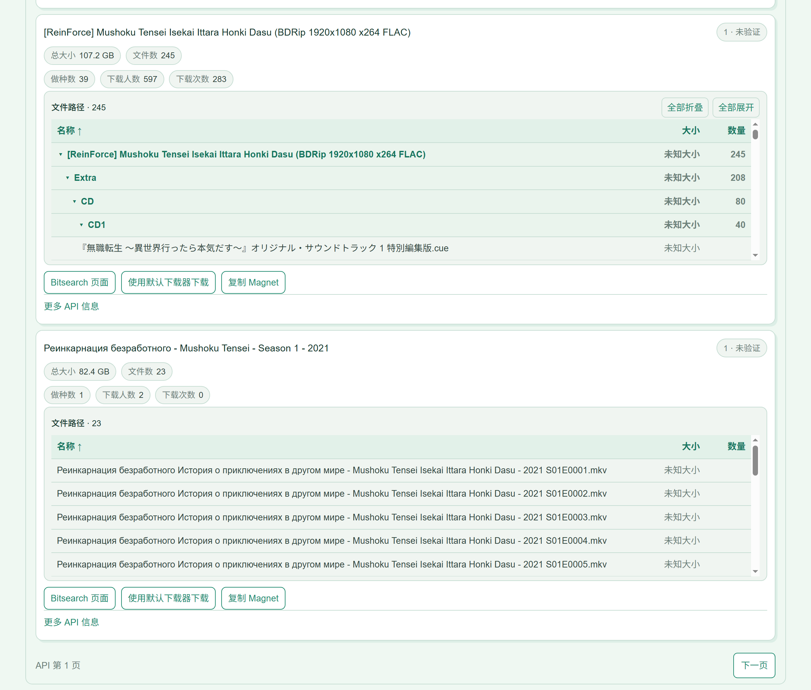

# Bitsearch Magnet Search

[中文说明](README.md) · [English](README_EN.md)

## 简介

在本机搜索 Bitsearch 的磁力资源。可按名称、文件路径、大小和日期筛选，查看文件清单并复制 Magnet 链接。搜索结果和已取得的文件信息保留 1 小时，重新打开软件后仍可复用。

## 如何配置

1. 在 Windows 上安装 Python 3，并确保可以使用 `py -3`；首次启动需要网络连接。
2. 如果有 Bitsearch API 密钥，启动前设置环境变量 `BITSEARCH_API_KEY`；没有密钥可跳过。
3. 双击 `start.bat`。首次运行会自动安装所需组件，随后打开浏览器。默认地址为 `http://127.0.0.1:8766/`。

## 如何使用

1. 输入名称，点击“搜索”；需要时再填写文件路径、大小或日期条件。
2. 如需查看文件清单或文件大小，勾选相应选项后搜索或翻页。缺失的大小显示为“未知大小”。
3. 在结果中查看、排序或折叠文件路径，使用默认下载器打开 Magnet，或复制链接。

