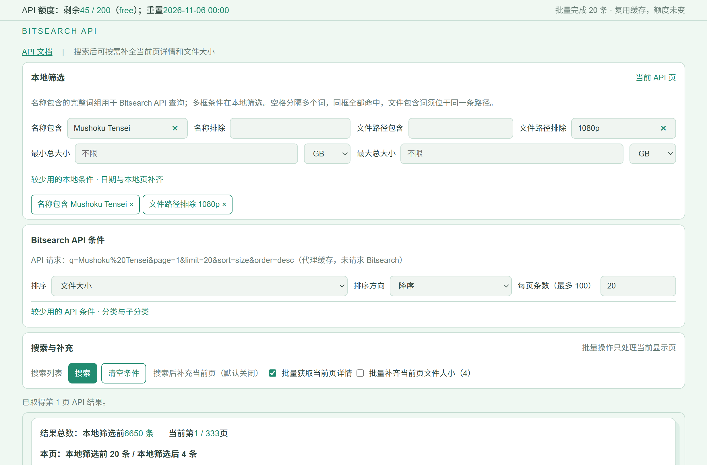
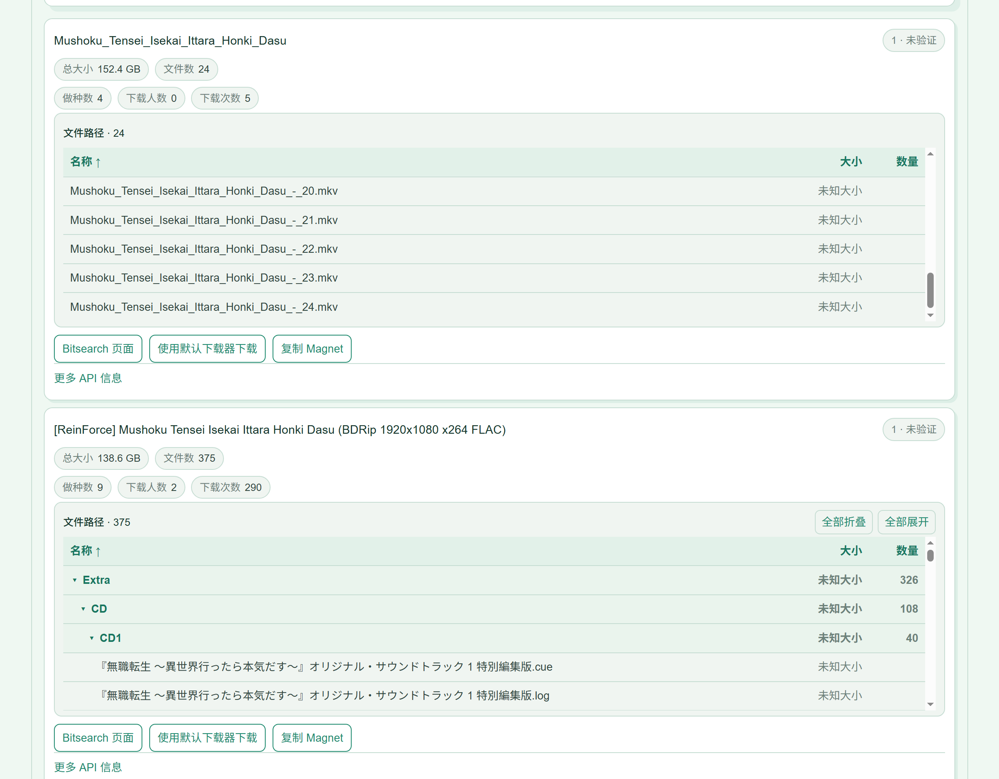
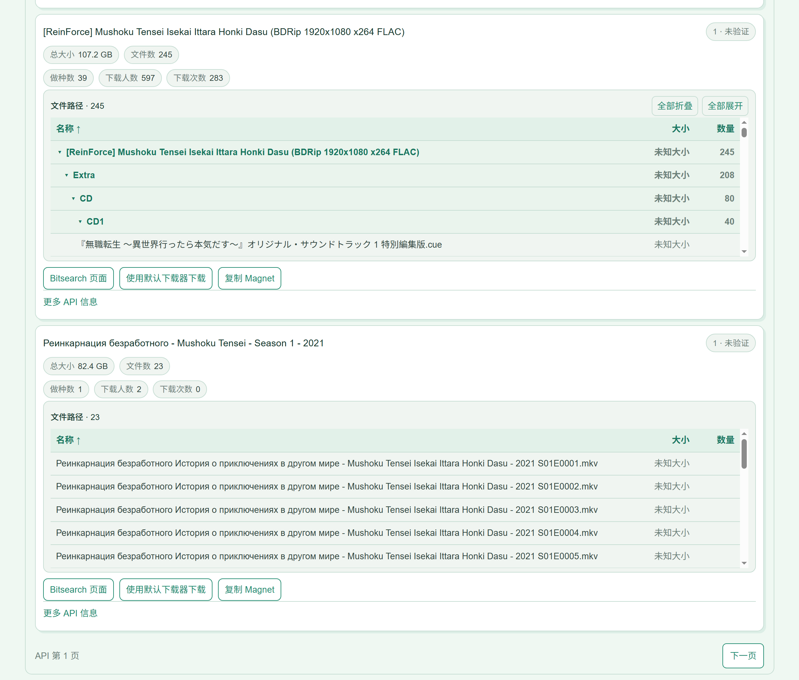

# Bitsearch Magnet Search

[中文说明](README.md) · [English](README_EN.md)

## Overview

Search Bitsearch magnet listings on your computer. Filter by name, file path, size, or date; view file lists and copy Magnet links. Results and fetched file information remain available for one hour after reopening the app.

## Configuration

1. Install Python 3 on Windows and make sure `py -3` works. The first launch needs a network connection.
2. If you have a Bitsearch API key, set `BITSEARCH_API_KEY` before starting. Otherwise, skip this step.
3. Double-click `start.bat`. The first run installs required components, then opens your browser. The default address is `http://127.0.0.1:8766/`.

## Usage

1. Enter a name and select Search. Add file path, size, or date filters when needed.
2. To see file lists or file sizes, select the corresponding checkbox and search or change pages. Missing sizes appear as unknown.
3. Browse, sort, or collapse file paths. Open a Magnet with your default downloader or copy its link.

